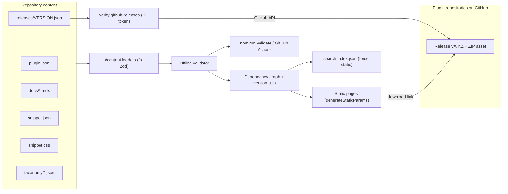

# Internal Plugin and CSS Documentation Portal: Implementation Plan

This plan describes a file-based, statically generated documentation portal for the agency's WordPress plugins and Flatsome CSS snippets. It is approved and ready to implement.

**How to use this plan:** implement one milestone at a time (section 12), in order, each as its own PR. Do not invent new architecture; where something is undecided, it is listed in section 14, and the default proposed in this plan applies until it is resolved. Before writing code, read `AGENTS.md` (this Next.js version has breaking changes, so consult `node_modules/next/dist/docs/`) and the shadcn skill in `.agents/skills/shadcn/SKILL.md`.

Technical documents, code, identifiers, and comments are in English. End-user content and UI text are Norwegian (`nb`) by default.

---

## 1. Existing project summary

Inspected: `package.json`, `components.json`, `app/layout.tsx`, `app/page.tsx`, `app/globals.css`, `components/ui/button.tsx`, `lib/utils.ts`, `next.config.ts`, `tsconfig.json`, `eslint.config.mjs`, `.gitignore`, `README.md`, `AGENTS.md`/`CLAUDE.md`, `skills-lock.json`, `.vercel/repo.json`, the shadcn skill, and the bundled Next.js 16 docs (`node_modules/next/dist/docs`: MDX, `generateStaticParams`, static exports, route handlers).

- **Framework:** Next.js `16.2.4` (App Router, Turbopack by default), React `19.2.4`, TypeScript strict, `@/*` path alias at the repo root (no `src/`).
- **Styling:** Tailwind CSS v4 (CSS-first, `@theme inline` in `app/globals.css`), `tw-animate-css`, light and dark tokens already defined, `--radius: 0`, teal primary.
- **shadcn/ui:** style `base-luma`, so primitives come from **Base UI** (`@base-ui/react`), not Radix. Custom triggers therefore use the `render` prop, not `asChild`. Icons: `lucide-react`. RSC is enabled. Only `components/ui/button.tsx` is installed. `cn` comes from shadcn's `cn` package (re-exported from `lib/utils.ts`), so keep it.
- **Fonts:** Raleway as `--font-sans` and Geist Mono for code. Geist Sans is loaded but unused because Raleway overrides `font-sans`.
- **Boilerplate still present:** `app/page.tsx` is the create-next-app page, `metadata` is a placeholder, and `<html lang="en">`.
- **Tooling:** ESLint 9 with `eslint-config-next`. There is no test runner, no CI, and no content directory.
- **Deployment:** `.vercel/repo.json` links the Vercel project `wordpress-plugins-docs`. The local workspace did not report as a git repository at planning time, so this needs confirming.
- **Environment note:** the local Node is `v20.17.0`, and the shadcn CLI warned that it needs `>=20.18.1`. Use Node 22 LTS locally and on Vercel, pinned through `engines.node`.
- **Skills:** the shadcn skill is present and is followed throughout this plan. There is no Vercel skill file in the repo; Vercel documentation was consulted directly.

## 2. Recommended architecture and rationale

**Decision: structured JSON for metadata, MDX for prose, raw `.css` files for snippet code. All of it is validated with Zod at build time and rendered as static pages.**



**Decision: the portal does not host ZIP files.** Each release JSON points to a ZIP **asset attached to a GitHub Release** in the plugin's own repository. The download URL is derived as `https://github.com/<owner>/<repo>/releases/download/<tag>/<asset>`. Why:

- GitHub Releases are already where plugin builds belong. There is one source of truth for binaries, and the docs repository stays small with no LFS or storage concerns.
- A release asset, unlike GitHub's auto-generated tag archive, is a proper WordPress-installable ZIP with the correct plugin folder name inside.
- **Private repositories get access control for free.** Only colleagues with access to the GitHub organization can download those assets, even though the portal itself has no authentication.
- The trade-off is that link correctness can't be checked offline. It is checked against the GitHub API in CI instead (see section 10).

Why each format:

- **JSON for metadata (plugins, releases, snippets, taxonomy).** Relationships such as dependencies, categories, tags, and related items have to be machine-checkable. JSON needs no parser dependency, can carry a `$schema` key so editors autocomplete it (the JSON Schema is generated from the Zod schemas), and can be imported in tests. YAML is friendlier to write but adds a parser and has whitespace pitfalls. TypeScript content files give type safety but blur the line between content and code, and they are harder for non-developers to edit.
- **MDX for long-form prose (descriptions, installation, usage).** It handles headings, lists, tables, and code blocks, and can embed a few portal components (for example `<Callout>`). With `@next/mdx`, MDX files are imported as modules and compiled at build time. Frontmatter is _not_ needed, because metadata lives in JSON. That avoids the frontmatter plugins the Next docs mention as an extra step.
- **A raw `.css` file for snippet code.** The copy button copies exactly what is in the file, with no escaping inside MDX or JSON. The file can be linted later (for example with Stylelint), and Git diffs stay clean.
- **Folder name is the slug, and file name is the version.** This keeps a single source of truth, so a mismatch between a `slug` field and the folder cannot happen.
- **Validation runs inside the loader**, so `next build` fails on invalid content. The same code powers a fast `npm run validate` and CI.
- **Static generation:** every dynamic route uses `generateStaticParams` and `export const dynamicParams = false`, so unknown slugs return 404. Cache Components are not enabled, because nothing is request-dependent.
- **No CMS, database, or external service at runtime.** Content changes go through pull requests, and Vercel preview deployments serve as the review environment. GitHub is used only as the download host and, in CI, for link verification. The site never calls the GitHub API at build time or at runtime, so builds stay deterministic and need no token on Vercel.

New dependencies, each with a reason (install each in the milestone where it is first needed):

- `@next/mdx`, `@mdx-js/loader`, `@mdx-js/react`, `@types/mdx`: the official MDX integration documented for this Next version.
- `zod` (v4): schema validation with typed output, plus `z.toJSONSchema()` for editor autocompletion.
- `shiki`: build-time syntax highlighting in Server Components, so no highlighter ships to the client. It supports CSS, PHP, and shell, and dual light/dark themes through CSS variables.
- `remark-gfm` (optional): GitHub-flavored tables and task lists in MDX. It is referenced by string name, as Turbopack requires.
- Dev only: `vitest` (unit tests for loaders, versions, and the dependency graph) and `tsx` (to run TypeScript scripts on Node 20 and 22).
- No GitHub SDK: the CI verification script uses plain `fetch` against the REST API.
- Not added: Fuse.js, MiniSearch, Algolia, next-intl, Contentlayer, Vercel Blob, or Playwright. Each is either unnecessary at the expected scale or listed as a future option.

## 3. Repository and directory structure

```
app/
  layout.tsx                       root: <html lang="nb">, fonts, SidebarProvider shell
  page.tsx                         home (replaces boilerplate)
  not-found.tsx
  robots.ts                        disallow all (internal site)
  plugins/page.tsx                 plugin overview
  plugins/[slug]/page.tsx          plugin detail
  css/page.tsx                     snippet overview (categories, tags, recent)
  css/[slug]/page.tsx              snippet detail
  css/category/[category]/page.tsx
  css/category/[category]/[subcategory]/page.tsx
  css/tag/[tag]/page.tsx
  search-index.json/route.ts       GET, dynamic = "force-static"
components/
  ui/                              shadcn-generated only (managed by CLI)
  layout/                          app-sidebar.tsx, site-header.tsx, page-header.tsx, page-breadcrumbs.tsx
  search/                          search-command.tsx (client)
  code/                            code-block.tsx (server, Shiki), copy-button.tsx (client)
  plugins/                         plugin-card, requirements-list, dependency-table, dependents-list,
                                   release-table, changelog, download-button, default-installation
  snippets/                        snippet-card, placement-callout, compatibility-notes, tag-badges
  mdx/                             components exposed to MDX (callout, etc.)
mdx-components.tsx                 required by @next/mdx (maps pre/code to CodeBlock, headings, links)
content/
  plugins/<slug>/
    plugin.json                    plugin-level metadata
    docs/overview.mdx              required: description and purpose
    docs/installation.mdx          optional: falls back to default WP install instructions
    docs/usage.mdx                 optional: usage examples
    releases/<version>.json        one immutable file per release
  snippets/<slug>/
    snippet.json
    snippet.css
    notes.mdx                      optional: explanation and variants
  taxonomy/
    snippet-categories.json        two-level category tree
    tags.json                      controlled tag vocabulary
lib/
  utils.ts                         existing
  strings.ts                       Norwegian UI strings (single dictionary)
  format.ts                        Intl date/size formatting (nb-NO)
  content/
    schemas.ts                     Zod schemas (single source of truth for types)
    paths.ts                       content path conventions
    github.ts                      derives release page and asset download URLs from tag/asset patterns
    versions.ts                    version parsing and comparison per scheme
    load-plugins.ts, load-snippets.ts, load-taxonomy.ts
    graph.ts                       dependency and dependents graph, cycle detection
    validate.ts                    cross-reference rules, returns a list of issues
    search-index.ts                builds the search records
    index.ts                       public, cached API: getPlugins(), getPlugin(slug), getSnippets(), ...
schemas/                           generated JSON Schemas (plugin, release, snippet, taxonomy)
scripts/
  validate-content.ts              npm run validate
  check-release-immutability.ts    CI: no deleted release files and no changed tag/asset/sha256 vs the base branch
  verify-github-releases.ts        CI: every tag and asset exists on GitHub, and its digest and visibility match
  generate-json-schemas.ts
  new-release.ts                   (later) scaffold a release JSON from a GitHub Release, refusing to overwrite
tests/
  content/*.test.ts
  fixtures/valid/..., fixtures/invalid/<rule>/...
.github/workflows/ci.yml
```

Separation: application code lives in `app/` and `components/`. Content lives in `content/` and is never imported by client components. Binaries live only in the plugin repositories' GitHub Releases, so the docs repository holds no ZIPs. Schemas and helpers live in `lib/content/`. Tooling lives in `scripts/` and `tests/`. Loader modules import `server-only` (confirm that Next 16 resolves it without an extra package, and add the package if not).

## 4. Data models with concrete examples

The TypeScript types are inferred from the Zod schemas (`z.infer`). Data model summary:

- **Plugin** (from `plugin.json` plus its folder): `slug` (folder), `name`, `summary`, `versionScheme`, `status`, `repository { owner, repo, visibility, tagPattern?, assetPattern? }`, `tags?`, `maintainer?`, `replacedBy?`, `related { plugins?, snippets? }`.
  - `status` is `active`, `deprecated`, or `archived`.
  - `visibility` is `public` or `private`. It is declared per plugin, because the repositories are a mix of both.
  - `tagPattern` defaults to `"v{version}"` and `assetPattern` defaults to `"{slug}-{version}.zip"`. Plugins that follow the defaults need no extra fields. Plugins with other conventions (for example tags without a `v`) override them once, not per release.
- **Release** (from `releases/<version>.json`): `version` (file name), `releaseDate`, `channel` (`stable` | `beta`), `yanked? { reason }`, `requirements { wordpress, php, flatsome? }` (each `{ min, tested? }`), `dependencies[]`, `download? { tag?, asset?, sha256? }`, `changelog { added?, changed?, fixed?, removed?, security? }`.
  - `download.tag` and `download.asset` override the plugin patterns for a single irregular release (for example an old release uploaded under another name).
  - `download.sha256` is recommended. CI compares it with the digest GitHub reports for the asset, which detects an asset that was replaced after the fact.
- **Derived links** (computed in `lib/content/github.ts`, never typed by hand):
  - Asset: `https://github.com/<owner>/<repo>/releases/download/<tag>/<asset>`
  - Release page: `https://github.com/<owner>/<repo>/releases/tag/<tag>`
  - Repository: `https://github.com/<owner>/<repo>`
- **Dependency:** either `{ plugin: <internal slug> }` or `{ external: { name, slug?, url? } }`, plus `type` (`required` | `optional`), `minVersion?`, and `reason?`.
- **Snippet:** `slug` (folder), `name`, `summary`, `category`, `subcategory?`, `tags[]`, `placement { location, notes? }`, `compatibility? { flatsome?, notes? }`, `related?[]`, `updated`, and `author?`. The code is read from `snippet.css`.
- **Taxonomy:** categories `{ slug, label, description?, subcategories?[] { slug, label, description? } }`, and tags `{ slug, label, description? }`.

Relationships are stored in one direction only and the reverse is computed. A release declares its dependencies, and "used by" is derived in `graph.ts`. A snippet references a category and tags, and the category and tag pages are derived.

**Example: an internal library plugin using WordPress-style versions**

`content/plugins/agency-core/plugin.json`

```json
{
	"$schema": "../../../schemas/plugin.schema.json",
	"name": "Agency Core",
	"summary": "Felles hjelpefunksjoner og innstillingsside som brukes av byråets øvrige plugins.",
	"versionScheme": "dotted",
	"status": "active",
	"repository": {
		"owner": "ORG",
		"repo": "agency-core",
		"visibility": "private",
		"tagPattern": "{version}"
	},
	"tags": ["library"],
	"maintainer": "Team Web"
}
```

Releases: `releases/2.0.json`, `releases/2.1.json`, `releases/2.1.1.json`. This repository tags releases without a `v`, so the plugin overrides `tagPattern` once. Release `2.1.1` then resolves to `https://github.com/ORG/agency-core/releases/download/2.1.1/agency-core-2.1.1.zip`.

**Example: a plugin with multiple semver releases and dependencies**

`content/plugins/flatsome-product-badges/plugin.json`

```json
{
	"$schema": "../../../schemas/plugin.schema.json",
	"name": "Flatsome Product Badges",
	"summary": "Legger til egendefinerte merker på produktkort i Flatsome.",
	"versionScheme": "semver",
	"status": "active",
	"repository": {
		"owner": "ORG",
		"repo": "flatsome-product-badges",
		"visibility": "public"
	},
	"tags": ["woocommerce", "product-cards"],
	"related": {
		"plugins": ["agency-core"],
		"snippets": ["product-card-badge-position"]
	}
}
```

`content/plugins/flatsome-product-badges/releases/1.3.0.json`

```json
{
	"$schema": "../../../../schemas/release.schema.json",
	"releaseDate": "2026-09-02",
	"channel": "stable",
	"requirements": {
		"wordpress": { "min": "6.4", "tested": "6.8" },
		"php": { "min": "8.1" },
		"flatsome": { "min": "3.18.0", "tested": "3.20.1" }
	},
	"dependencies": [
		{ "plugin": "agency-core", "type": "required", "minVersion": "2.1" },
		{
			"external": {
				"name": "WooCommerce",
				"slug": "woocommerce",
				"url": "https://wordpress.org/plugins/woocommerce/"
			},
			"type": "required",
			"minVersion": "8.5"
		},
		{
			"external": {
				"name": "Advanced Custom Fields PRO",
				"url": "https://www.advancedcustomfields.com/pro/"
			},
			"type": "optional",
			"minVersion": "6.2",
			"reason": "Gir merker per produkt."
		}
	],
	"download": { "sha256": "<64 hex chars>" },
	"changelog": {
		"added": ["Støtte for merker på kategorisider."],
		"fixed": ["Merker vises ikke lenger dobbelt i hurtigvisning."]
	}
}
```

Other releases sit alongside it: `1.2.0.json` (depends on `agency-core` `2.0`), `1.2.1.json`, and `2.0.0-beta.1.json` (`"channel": "beta"`). With the default patterns, their download links are derived as:

```
https://github.com/ORG/flatsome-product-badges/releases/download/v1.2.0/flatsome-product-badges-1.2.0.zip
https://github.com/ORG/flatsome-product-badges/releases/download/v1.2.1/flatsome-product-badges-1.2.1.zip
https://github.com/ORG/flatsome-product-badges/releases/download/v1.3.0/flatsome-product-badges-1.3.0.zip
https://github.com/ORG/flatsome-product-badges/releases/download/v2.0.0-beta.1/flatsome-product-badges-2.0.0-beta.1.zip
```

An irregular old release overrides only what differs, for example `"download": { "asset": "product-badges.zip" }` in `1.2.0.json`.

**Example: a CSS snippet**

`content/snippets/header-dropdown-shadow/snippet.json`

```json
{
	"$schema": "../../../schemas/snippet.schema.json",
	"name": "Skygge på nedtrekksmeny",
	"summary": "Gir nedtrekksmenyer i headeren en myk skygge og en tynn kant.",
	"category": "header",
	"subcategory": "dropdown-menus",
	"tags": ["shadow", "border"],
	"placement": {
		"location": "flatsome-custom-css-all",
		"notes": "Lim inn i feltet for alle skjermstørrelser."
	},
	"compatibility": {
		"flatsome": { "min": "3.17.0", "tested": "3.20.1" },
		"notes": "Forutsetter standard dropdown-stil i Theme Options."
	},
	"related": ["header-dropdown-arrow", "navbar-link-underline"],
	"updated": "2026-08-10"
}
```

`content/snippets/header-dropdown-shadow/snippet.css`

```css
/* Skygge på nedtrekksmeny */
.header-nav .nav-dropdown {
	border: 1px solid rgba(0, 0, 0, 0.06);
	box-shadow: 0 10px 30px rgba(0, 0, 0, 0.12);
}
```

`content/taxonomy/snippet-categories.json` (excerpt)

```json
{
	"categories": [
		{
			"slug": "header",
			"label": "Header",
			"description": "Navigasjon, menyer og elementer i toppen av siden.",
			"subcategories": [
				{ "slug": "navbar", "label": "Navigasjon" },
				{ "slug": "dropdown-menus", "label": "Nedtrekksmenyer" }
			]
		},
		{ "slug": "buttons", "label": "Knapper" }
	]
}
```

`content/taxonomy/tags.json` (excerpt)

```json
{
	"tags": [
		{ "slug": "shadow", "label": "Skygge" },
		{ "slug": "border", "label": "Kantlinje" },
		{ "slug": "responsive", "label": "Responsiv" }
	]
}
```

## 5. Information architecture and navigation

Routes, with English segments by default (see open questions):

- `/`: the home page. It has a search trigger, counts for each content type, the five latest plugin releases, the five most recently updated snippets, and category shortcuts.
- `/plugins`: a Card grid of all plugins, with a client-side text filter plus status and tag filters (a `ToggleGroup`).
- `/plugins/[slug]`: plugin detail, described below.
- `/css`: a category grid with counts, a tag list, and recently updated snippets.
- `/css/category/[category]` and `/css/category/[category]/[subcategory]`: snippet lists. Subcategory filters are links, so they work without JavaScript.
- `/css/tag/[tag]`: snippets with a given tag.
- `/css/[slug]`: snippet detail. The slugs `category` and `tag` are reserved and rejected by validation.

**Sidebar decision:** use the shadcn `Sidebar` with two `SidebarGroup`s. Each group is a `Collapsible`, open by default.

- **Plugins:** an "All plugins" link plus every plugin listed directly in alphabetical order. The expected count is in the tens, so a flat list is the fastest path. If the list grows past about 30, group plugins by a `group` field (see future work).
- **CSS snippets:** an "All snippets" link plus **categories only**, each expandable to its subcategories with counts. Individual snippets are _not_ listed, because there may be hundreds. The category of the active snippet is expanded and highlighted. This scales without the sidebar turning into a wall of links.
- **Active state:** `SidebarMenuButton isActive` is driven by `usePathname()` in the client `AppSidebar`. The navigation data is built on the server in the root layout and passed in as a small serializable prop.
- **Mobile:** the Sidebar's built-in off-canvas `Sheet` mode, opened by a `SidebarTrigger` in the sticky site header. The header also holds the search button.
- **Breadcrumbs** (`Breadcrumb`) on all detail and category pages, for example: Hjem / CSS / Header / Nedtrekksmenyer / Skygge på nedtrekksmeny.
- **Empty states** use `Empty`: no plugins yet, no snippets in a category, no releases, no results, and on the not-found page.

Plugin detail page, top to bottom:

1. A page header with the name, summary, a badge for the latest version, a status badge, a visibility badge ("Privat repo" or "Offentlig repo"), the primary button "Last ned v1.3.0" (the GitHub asset link), and a secondary "Se på GitHub" link to the repository.
2. An `Alert` if the plugin is deprecated, shown with `replacedBy`, or if the latest version is a beta. For **private** repositories, a short info note says the download requires being signed in to GitHub with access to the organization; otherwise GitHub returns 404.
3. Requirements: WordPress, PHP, and Flatsome minimum and tested versions for the latest release.
4. Dependencies (`Table`): internal plugins are linked, with a Required/Optional `Badge`, the minimum version, and whether the target's current latest version satisfies it. External dependencies link out.
5. "Brukes av" (used by): plugins whose latest release depends on this plugin.
6. Overview MDX, then installation MDX (or the default instructions), then usage MDX.
7. Versions: a `Table` of all releases, newest first, with date, channel, and compatibility, plus per row a download link (asset), a link to the GitHub release page, and the SHA-256 with a copy button when present. Each changelog sits in an `Accordion`, and each row has an anchor `#v1-3-0`.
8. Related plugins and snippets.

Snippet detail page: header with category and tag badges, the placement callout ("Hvor skal CSS-en limes inn?"), compatibility notes, the code block with a copy button, `notes.mdx`, and related snippets.

## 6. Plugin versioning and dependency management

- **One file per release** (`releases/<version>.json`), each pointing to its own GitHub tag and asset. Adding a release only ever _adds_ a file, so nothing older is overwritten by construction. Git also shows any accidental edit of an existing file in review.
- **Immutability is enforced on both sides:**
  - **In this repository:** `scripts/check-release-immutability.ts` compares changed release files with the base branch. It fails if a release file is deleted or renamed, or if its effective `tag`, `asset`, or `sha256` changes. Release JSON can still be edited for `yanked`, changelog typos, or compatibility notes. A real exception requires an admin bypass of branch protection.
  - **On GitHub:** a maintainer could delete or replace a release asset in the plugin repository, and this repository would not notice. Mitigations: enable GitHub's immutable releases setting on the plugin repositories (or organization), which locks the assets and tag after publishing; verify that it is available on your GitHub plan. In addition, `scripts/verify-github-releases.ts` compares the recorded `sha256` with the asset digest reported by the GitHub API, so a replaced asset fails CI.
- **Old versions remain available** as long as their GitHub Releases are kept. The rule is documented for plugin repositories: never delete a published release; mark it yanked here instead.
- **Version schemes are per plugin** (`versionScheme`):
  - `semver`: `MAJOR.MINOR.PATCH`, with an optional `-prerelease`.
  - `dotted`: 2 to 4 numeric parts (`2.1`, `2.1.1`, `1.0.0.3`), as is common in WordPress plugins.
  - `calver`: `YYYY.MM` or `YYYY.MM.N`.

  Validation uses a per-scheme regex. Ordering uses one small numeric dotted comparator with semver prerelease rules, so the `semver` package is not needed. A leading `v` is forbidden, which prevents `v1.0.0` and `1.0.0` from both existing.

- **Latest** is the highest version that is `channel: "stable"` and not yanked. If no stable release exists, the highest beta is shown with a warning. Yanked releases stay listed and downloadable, but marked, which keeps a full history.
- **Dependencies are per release**, because they change over time. The plugin page shows the dependencies of the latest release, and each row in the version table shows its own. `minVersion` is validated against the _target_ plugin's scheme.
- **Graph checks:** no self-dependencies; required-dependency cycles are an error; optional cycles are a warning. A warning is raised when `minVersion` is higher than the target's latest release.
- **Download URLs** are derived from the repository, the tag pattern, and the asset pattern, and are never typed by hand. Version tags in the plugin repositories must therefore match the versions in this repository, which the CI verification checks.
- **Future:** a stable portal URL `/plugins/<slug>/latest.zip` that redirects to the latest stable asset, generated as `redirects()` in `next.config.ts` from the content at build time. GitHub's own `releases/latest/download/<asset>` can't be used, because asset names contain the version.

## 7. CSS snippet organization, categories, and tags

**Principle:** a _category_ says **where** a snippet applies (a Flatsome area or component). A _tag_ says **what** it does (a styling aspect or condition). Cross-cutting concerns such as responsiveness, shadows, borders, and links are tags, not categories. That avoids deep trees and duplicate filing. Categories have at most two levels, and every snippet has exactly one category and at most one subcategory.

Proposed starting tree (English slugs, Norwegian labels):

- `header`: `navbar`, `dropdown-menus`, `mobile-menu`, `sticky-header`, `header-elements` (search, cart, account icons)
- `footer`
- `buttons`
- `blog`: `blog-cards`, `post-meta`, `pagination`, `single-post`
- `shop` (WooCommerce, which Flatsome is built around): `product-cards`, `product-page`, `cart-checkout`
- `layout-elements` (UX Builder sections, rows, banners, sliders, tabs, accordions)
- `forms`
- `typography`
- `misc`

Starting tags: `responsive`, `mobile`, `tablet`, `desktop`, `shadow`, `border`, `links`, `hover`, `animation`, `colors`, `spacing`, `sticky`, `accessibility`, `woocommerce`, `ux-builder`, `dark-background`. Keep the vocabulary to roughly 15 to 30 tags, and grow it through PRs. Validation warns about tags nobody uses.

**Placement** is an enum with Norwegian labels and step-by-step text:

- `flatsome-custom-css-all`
- `flatsome-custom-css-tablet`
- `flatsome-custom-css-mobile`
- `child-theme-stylesheet`
- `wordpress-additional-css`
- `other` (requires `notes`)

The three Flatsome values map to the "Custom CSS" fields in Flatsome's Advanced theme options; confirm the exact labels against the current Flatsome version. Validation warns when a snippet placed in the tablet or mobile field contains `@media` rules, because those fields are already scoped by screen size.

**Code viewer:**

- `CodeBlock` is a Server Component. It highlights with Shiki, using a cached highlighter singleton loaded with only the `css`, `php`, `bash`, `json`, and `js` languages, and dual light/dark themes through CSS variables.
- Horizontal scrolling (`overflow-x-auto`) instead of wrapping, so indentation is preserved. The scroll region gets `tabIndex={0}` and an `aria-label` so keyboard users can scroll it.
- Blocks longer than about 30 lines are capped in height and get a `Collapsible` "Vis hele koden" toggle.
- `CopyButton` is a client component that copies the _raw source_, not the highlighted HTML, using `navigator.clipboard`. Its icon changes to a check and a polite `aria-live` message says "Kopiert". It is pinned top-right with a touch-sized target.
- The same `CodeBlock` handles fenced code blocks in MDX through `mdx-components.tsx`. If async components inside the MDX components map cause trouble, fall back to `@shikijs/rehype`.

## 8. Component plan (shadcn/ui)

Add the components with `npx shadcn@latest add ...`, check the docs with `npx shadcn@latest docs <name>`, and review the generated files after adding them, as the skill requires:

- `sidebar` (pulls in `sheet`, `tooltip`, `separator`, `skeleton`, `input`), `collapsible`, `breadcrumb`
- `card`, `badge`, `table`, `accordion`, `alert`, `empty`, `kbd`, `item`
- `command` and `dialog` for search, and `toggle-group` for overview filters

Rules from the skill that apply:

- Use the `render` prop with Base UI, for example `<SidebarMenuButton render={<Link href=... />} isActive={...}>`.
- Use `gap-*` instead of `space-y-*`, and semantic tokens with no raw colors or manual `dark:` overrides.
- Icons inside buttons get `data-icon`, and Dialog/Sheet always have a title (the title can be `sr-only`).
- Use `Empty` for empty states, `Alert` for callouts, and `Badge` for statuses.

Custom components are thin compositions only: `PageHeader`, `PageBreadcrumbs`, `CodeBlock`, `CopyButton`, `DownloadButton` (a `Button` rendered as a plain `<a>` to the GitHub asset; the `download` attribute is ignored for cross-origin URLs, and GitHub already serves assets as attachments), `DependencyTable`, `ReleaseTable`, `PlacementCallout`, `PluginCard`, `SnippetCard`, `SearchCommand`. Prose styling is a small set of MDX component mappings (headings, lists, links, tables) using existing tokens. `@tailwindcss/typography` is not added unless the mappings become unwieldy.

Language: `<html lang="nb">`, every UI string in `lib/strings.ts` (Norwegian), and dates formatted with `Intl.DateTimeFormat("nb-NO")`. Adding English later means adding a second dictionary; no i18n framework is needed now.

## 9. Search, static generation, and performance

- **Index:** `lib/content/search-index.ts` builds one record per plugin, snippet, and category: `{ type, slug, title, summary, url, category, tags, keywords }`. For snippets, `keywords` includes the **class and ID selectors extracted from the CSS** (for example `.nav-dropdown`), because developers often search by Flatsome class name. The full CSS body is not indexed, because it adds noise and size. For plugins, keywords include the dependency names.
- **Delivery:** `app/search-index.json/route.ts` with `export const dynamic = "force-static"` produces a static JSON file at build time. The search dialog fetches it only the first time it opens, so pages carry no index payload. The estimated size is under 100 KB uncompressed for several hundred items.
- **UI:** shadcn `Command` inside `Dialog`, opened from a header button or `Ctrl/Cmd+K`. Results are grouped into Plugins, CSS snippets, and Categories. cmdk's built-in fuzzy filter over `value` and `keywords` is enough at this scale. Switch to MiniSearch only if the index exceeds about 1,000 items or ranking becomes a problem.
- **Static generation:** all pages are prerendered with `generateStaticParams` and `dynamicParams = false`. Loaders read the file system only at build time and are memoized (React `cache` or a module-level promise) so each build worker parses content once.
- **Client JavaScript is limited to** the sidebar (a shadcn client component), search, copy buttons, collapsibles and accordions, and the plugin overview filter. Everything else is a Server Component. Shiki and MDX compilation never reach the client.
- **Caching:** Vercel serves the prerendered pages and the search index from its CDN. Downloads are served by GitHub, so the portal adds no bandwidth or storage cost.

## 10. Validation and automated testing strategy

The offline checks share one implementation (`lib/content/validate.ts`). The GitHub link check is separate because it needs network access and a token:

1. **Build-time (offline):** the loaders throw a readable, aggregated error list, so `next build` fails and a bad merge cannot deploy.
2. **Local (offline):** `npm run validate` (`tsx scripts/validate-content.ts`) prints every problem with its file path. The generated JSON Schemas (`npm run schemas`) give inline editor errors through `$schema`.
3. **CI (GitHub Actions, on PRs and on main):** `validate`, `lint`, `tsc --noEmit`, `vitest run`, `check-release-immutability`, `verify-github-releases`, and `next build`. Make these required checks with branch protection.
4. **Scheduled CI (weekly):** `verify-github-releases` also runs on a schedule, so assets that are deleted or replaced in a plugin repository later are caught even when this repository doesn't change. The workflow opens an issue or fails visibly.

**GitHub link verification (`scripts/verify-github-releases.ts`):**

- For each release it calls `GET /repos/{owner}/{repo}/releases/tags/{tag}` and checks that the asset name exists in the response.
- It checks that the asset's reported digest matches `download.sha256`, when one is recorded.
- It checks that the repository's actual visibility matches the declared `visibility`, so the "private" note on the page stays truthful.
- **Authentication:** private repositories return 404 without a token, so an unauthenticated `HEAD` request on the download URL is not enough. CI uses a read-only token with access to all plugin repositories, stored as a repository secret (for example a fine-grained personal access token with read access to Contents and Metadata, or a GitHub App installation token).
- Requests are made per repository, and results are cached within the run to stay well under API rate limits.
- Locally the script runs with `GITHUB_TOKEN` if one is set; otherwise it prints a notice and skips. The script never runs during `next build` on Vercel.

Rules (E = error, W = warning):

- Slugs: kebab-case regex `^[a-z0-9]+(-[a-z0-9]+)*$` (E). Unique within each type, case-insensitively (E). Reserved slugs `category` and `tag` under `/css` (E).
- Required fields, field types, and ISO dates come from the Zod schemas (E). A release date in the future is W.
- Versions: the file name must be valid for the plugin's `versionScheme` (E). Duplicates after normalization (E). No leading `v` (E).
- Repository and download fields (offline):
  - `owner` and `repo` match GitHub's naming rules (E). `tagPattern` and `assetPattern` contain `{version}` (E) and only the known placeholders `{version}` and `{slug}` (E).
  - The derived asset name ends in `.zip` (E). `sha256` is 64 hex characters when present (E). A missing `sha256` is W.
  - Two releases resolving to the same tag and asset (E).
- GitHub (online, CI only): the tag exists (E), the asset exists on that release (E), the digest matches (E), and the declared visibility matches (E). A draft release, or a prerelease on GitHub that is marked `stable` here, is W.
- References:
  - Dependency, related, and `replacedBy` slugs exist (E). No self-dependency (E).
  - `minVersion` is valid in the target's scheme (E), and a value above the target's latest version is W.
  - A required-dependency cycle is E; an optional cycle is W.
- Taxonomy:
  - Duplicate category, subcategory, or tag slugs or labels (E). More than two category levels (E).
  - A snippet's category or subcategory doesn't exist, or the subcategory doesn't belong to that category (E).
  - An unknown tag (E), and an unused tag (W).
- Files: a plugin missing `docs/overview.mdx` (E), an empty `snippet.css` (E), and a plugin with no releases (W, shown as an empty state).

Tests (Vitest): version parsing and ordering for each scheme, URL derivation from patterns and overrides, the GitHub verification logic against mocked API responses (no network in unit tests), latest-release selection, graph and reverse dependencies, cycle detection, selector extraction, and one fixture directory per validation rule under `tests/fixtures/invalid/` that asserts the expected issue code. Accessibility is covered by `eslint-config-next` (jsx-a11y rules) plus a manual checklist per milestone: keyboard navigation, focus visibility, `lang`, contrast, and 200% zoom. Playwright end-to-end tests are future work.

## 11. Security and deployment considerations

- **ZIP storage:** ZIPs live only as GitHub Release assets in the plugin repositories (GitHub allows up to 2 GiB per asset). The docs repository and the Vercel deployment contain no binaries, so Git LFS and external storage are unnecessary.
- **Access control for downloads:** GitHub enforces it. Assets in private repositories can be downloaded only by people signed in to GitHub with access, so the portal's lack of authentication does not expose them. Assets in public repositories are public by definition.
- **Access control for the documentation itself (see open questions):** the pages are still public. They expose plugin names, descriptions, dependencies, and private repository names. Options:
  - Accept this with `noindex` and `robots` disallow.
  - Vercel Deployment Protection (Vercel Authentication for team members; password or IP protection depending on plan).

  Because downloads are protected by GitHub, this decision is less critical than it would be if the portal hosted the ZIPs.
- **Never embed tokens in links.** Download links are plain GitHub URLs. The CI token is used only by the verification script, is read-only, and is never exposed to Vercel or the client.
- **Always (MVP):** `app/robots.ts` disallows everything, plus an `X-Robots-Tag: noindex` header sitewide.
- **Content is code:** MDX can execute JSX at build time, so only trusted contributors may merge. Use branch protection, required review, and required CI.
- **Broken downloads** are prevented by pattern-derived URLs, offline format validation, the GitHub verification on every PR and weekly, the immutability check, and immutable releases on GitHub. The SHA-256 is shown on the page so a download can be verified.
- **Vercel:** Git-based deployments with a preview per PR. Set the Node version in project settings, matching `engines.node`. No environment variables are needed on Vercel; the GitHub token exists only as a GitHub Actions secret.

## 12. Phased implementation roadmap

Each milestone is a separate PR and must pass lint, typecheck, and build. Milestones M0 to M6 are the MVP; M7 is optional.

**M0: Foundation cleanup**

- Pin Node 22 (`engines`, `.nvmrc`).
- Set `lang="nb"` and real `metadata`. Remove the unused Geist Sans.
- Replace the boilerplate `app/page.tsx` with a placeholder home page. Add `lib/strings.ts`, `lib/format.ts`, `robots.ts`, and the noindex header.
- Add `vitest` and `tsx`, and the scripts `validate`, `test`, and `typecheck`.

Acceptance: `npm run build`, `lint`, and `typecheck` pass. The page renders in Norwegian with no boilerplate left.

**M1: Content model and validation**

- Install `zod`.
- Write `lib/content/*` (schemas, paths, github, versions, loaders, graph, validate) and the taxonomy files.
- Add seed content: 2 plugins (one `semver` with 3 to 4 releases, one `dotted`), ideally pointing at real plugin repositories (one public, one private), and 4 to 6 snippets across 3 categories. If fictional repositories are used for now, they must be replaced before M6 turns on GitHub verification.
- Add `scripts/validate-content.ts`, `scripts/generate-json-schemas.ts`, and tests with fixtures.

Acceptance: `npm run validate` passes on the seed content. Each offline rule in section 10 has a failing fixture that produces the expected issue code. The build fails when the seed content is broken.

**M2: Layout and navigation**

- Add the shadcn components for the shell: `sidebar`, `collapsible`, `breadcrumb`, `empty`, `card`, `badge`.
- Build the `AppSidebar` from content (plugins listed flat, CSS as categories), the site header with mobile trigger, `PageHeader`, `PageBreadcrumbs`, `not-found.tsx`, and the home page.

Acceptance: the sidebar reflects the content automatically, and the active item is highlighted. It works as an off-canvas sheet on mobile and is fully keyboard-operable. Unknown routes show the `Empty`-based 404.

**M3: Plugin pages**

- Set up MDX (`@next/mdx`, `mdx-components.tsx`, optionally `remark-gfm`) and `CodeBlock` with Shiki, plus `CopyButton`.
- Build `/plugins` (grid and filter) and `/plugins/[slug]` with requirements, dependencies, used by, MDX sections, the release table with GitHub asset and release-page links and changelog accordions, related items, and the private-repository note.

Acceptance: every plugin is prerendered. Download links match the derived GitHub URL format for default and overridden patterns, as covered by unit tests. Private plugins show the visibility badge and access note. Dependencies link both ways. Latest-version selection ignores betas and yanked releases. Deprecated and beta alerts appear. The default installation text shows when `installation.mdx` is missing.

**M4: CSS snippet pages**

- Build `/css`, the category and subcategory pages, tag pages, and `/css/[slug]` with the placement callout, compatibility notes, highlighted code with copy, notes MDX, and related snippets.

Acceptance: copy puts the exact `snippet.css` bytes on the clipboard and announces it to screen readers. Long code scrolls horizontally on a 360 px viewport without the page overflowing. Empty categories show `Empty`.

**M5: Global search**

- Build the search index (including selector keywords), the `force-static` route, and `SearchCommand` (`command`, `dialog`, `kbd`) with `Ctrl/Cmd+K`.

Acceptance: the index is a static asset fetched only when the dialog first opens. Searching by name, summary, category, tag, or a Flatsome class such as `.nav-dropdown` finds the right item. The dialog is fully keyboard-operable.

**M6: CI, contributor docs, hardening**

- Add `.github/workflows/ci.yml` (on PR, on main, and weekly), `check-release-immutability.ts`, `verify-github-releases.ts`, and the read-only token secret.
- Add a README section "Slik legger du til en plugin, versjon eller snippet" covering the file layout, an example, and the commands. Add a short checklist for plugin repositories: tag naming, asset naming, attach the built ZIP to the release, never delete releases, and enable immutable releases.
- Do an accessibility pass and decide on Deployment Protection.

Acceptance: CI fails with a clear message for each of these PRs: one that changes the tag or asset of an existing release, one that references a missing plugin, one that adds an invalid version, and one that points to a tag or asset that doesn't exist on GitHub, for both a public and a private repository. The weekly run reports an asset deleted on GitHub. The README lets a new colleague add a release without help.

**M7 (optional, after the MVP)**

- `scripts/new-release.ts <slug> <version>`: reads the GitHub Release through the API, fills in the date, digest, and release notes as a draft changelog, writes the release JSON, and refuses to overwrite an existing file.
- `latest.zip` redirects, a dark-mode toggle (`next-themes`), and an on-page table of contents.
- In CI, download each new asset and verify that the plugin header `Version:` inside the ZIP matches (needs a zip reader).
- Stylelint for snippets, a line-wrap toggle in the code viewer, and Playwright smoke tests.
- Plugin grouping in the sidebar, an English UI dictionary, and a reusable GitHub Action in the plugin repositories that builds the ZIP, publishes the release, and opens a release PR here automatically.

## 13. Acceptance criteria summary

The MVP is done when milestones M0 to M6 meet their criteria, and in addition:

- Adding a plugin, release, or snippet requires only new files under `content/` (plus a published GitHub Release in the plugin repository), with no code changes.
- The docs repository contains no ZIP files.
- Lighthouse accessibility is at least 95 on the home page, a plugin page, and a snippet page.
- All pages are statically prerendered, per the `next build` output.

## 14. Open questions and decisions

Until these are resolved, implement the default proposed in this plan.

1. **Access control for the docs pages:** downloads from private repositories are protected by GitHub. Is it acceptable that the documentation pages (names, descriptions, dependencies, private repository names) are publicly reachable with `noindex`, or should Vercel Deployment Protection be used?
2. **GitHub token for CI:** who owns the read-only token or GitHub App that can read all plugin repositories, including private ones? Is a fine-grained personal access token acceptable, or should it be an organization GitHub App?
3. **Release conventions in the plugin repositories:** do the existing repositories already attach a built ZIP to each release, and what tag and asset names do they use? This decides the default `tagPattern` and `assetPattern`, and how many old releases need overrides or a retroactive upload.
4. **Immutable releases on GitHub:** can this be enabled for the organization or the plugin repositories (subject to plan availability)?
5. **Source of release metadata:** keep release JSON maintained by hand in this repository (the default), or later generate it from GitHub Releases (`new-release.ts`, or an automated PR from the plugin repositories)?
6. **URL and slug language:** English segments and slugs (`/plugins`, `/css/category/header`, the default) or Norwegian (`/kategori`, `/tagg`)? Labels are Norwegian either way.
7. **Who edits content:** developers only (JSON and MDX are fine) or also non-developers? If the latter, YAML or the release scaffolding script should move into the MVP.
8. **Beta releases:** should they be shown to everyone (the default), or hidden behind a toggle?
9. **Dark mode:** is it needed in the MVP? The tokens already exist; it needs `next-themes`. Default: not in the MVP.
10. **Flatsome placement labels:** confirm the exact names of the Custom CSS fields in the Flatsome version in use.
11. **Repository state:** the workspace did not report as a git repository at planning time. Confirm the GitHub repository and branch protection setup that CI relies on.
